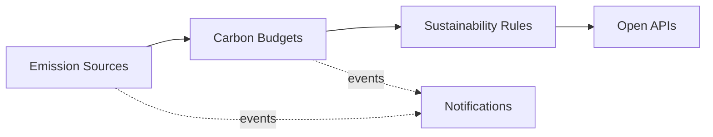

# Domain Model and Bounded Contexts

Ubiquitous language and context design (view VP-4). Domain-standard concepts are mapped
normatively in `../domain/domain-standards.md` (CR-5).

## Ubiquitous language (selected terms)

| Term | Meaning |
|---|---|
| **Emission source** | A registered source at a facility (energy, transport, process, waste) |
| **Carbon budget** | A facility's verified emissions allowance in kg CO2e for a period |
| **Emission entry** | One booked emission against a carbon budget, by GHG scope |
| **Sustainability rule** | A decision rule binding a category to reduction capacity and audit envelopes |
| **Offset project** | A catalogued project (reforestation, renewables, methane capture) |
| **Carbon compliance verdict** | Excess emissions and verification coverage vs targets |

## Bounded contexts and invariants

### Emission Sources — `emission-source-service`
Registry of emission sources per facility. Lifecycle: `ACTIVE` → transitions
suspend, reactivate. Facility and emissions data is commercially and regulatorily sensitive: identifiers are internal, records are append-only evidence, and no personal data is required by any contract.

### Carbon Budgets — `carbon-budget-service`
Verified carbon budgets per facility and the emission entries booked against them. **Invariant (ADR-0004): a facility's emissions booked against its verified carbon budget never exceed that budget — an entry that would overrun it is rejected (422) and records nothing.** Consumption records are
append-only evidence; a rejected operation records nothing.

### Sustainability Rules — `sustainability-rules-service`
Decision rules binding emission categories to reduction capacity and audit envelopes. Only ACTIVE rules decide; evaluation order is by priority; every decision
is ALLOWED / DEGRADED / DENIED with the matched rule and a human-readable reason.

### Offset Projects — `offset-project-service`
Catalogue of offset projects under evaluation.

### Notifications — `notification-service`
Delivery trail for audit; recipients are never logged.

## Context map

